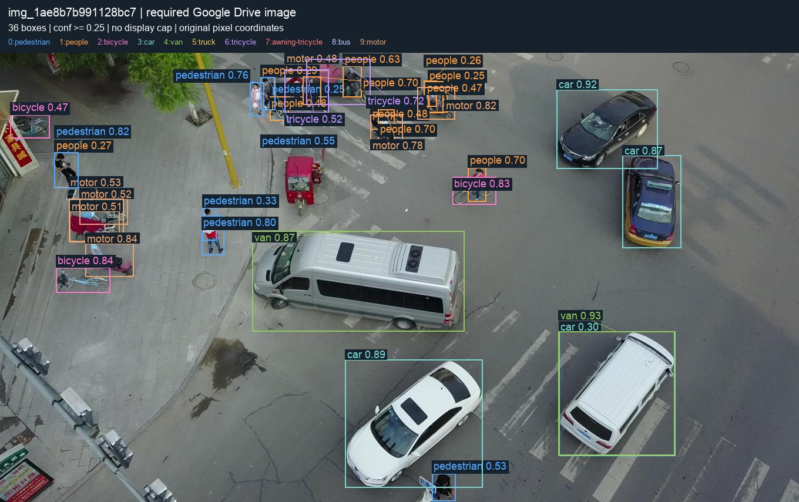
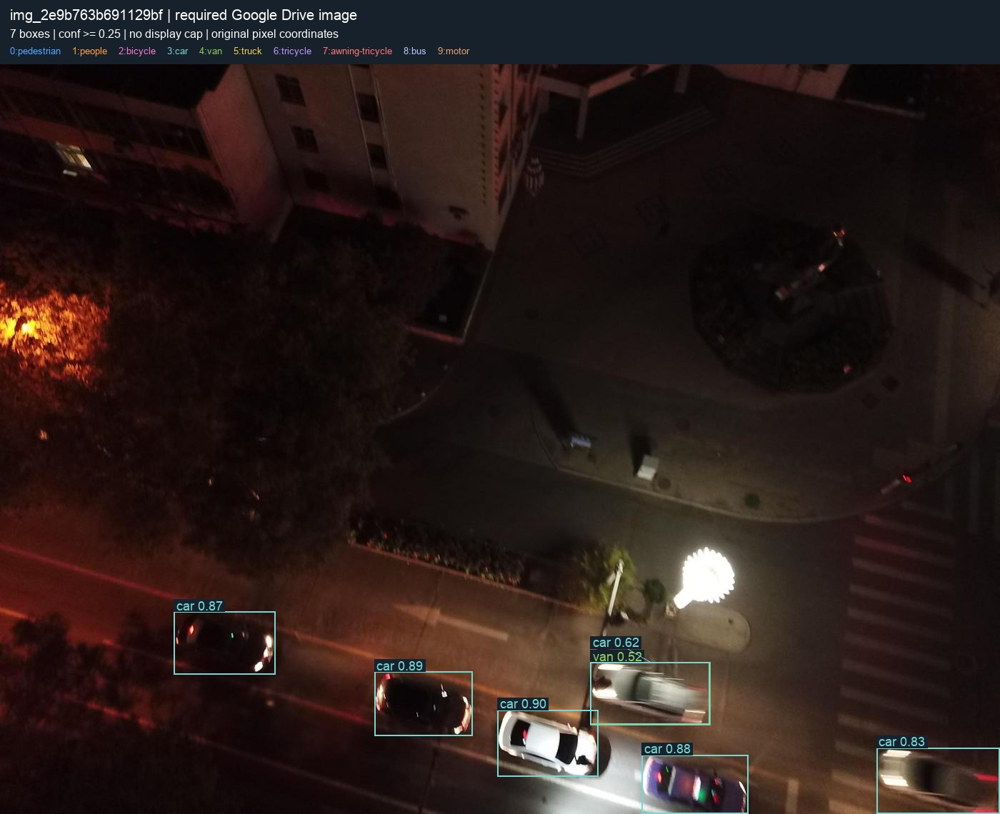
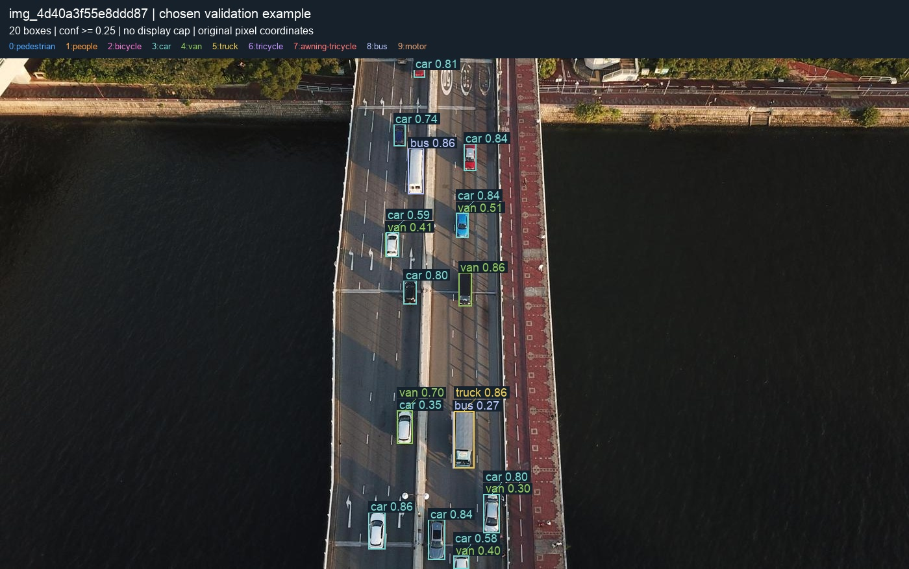
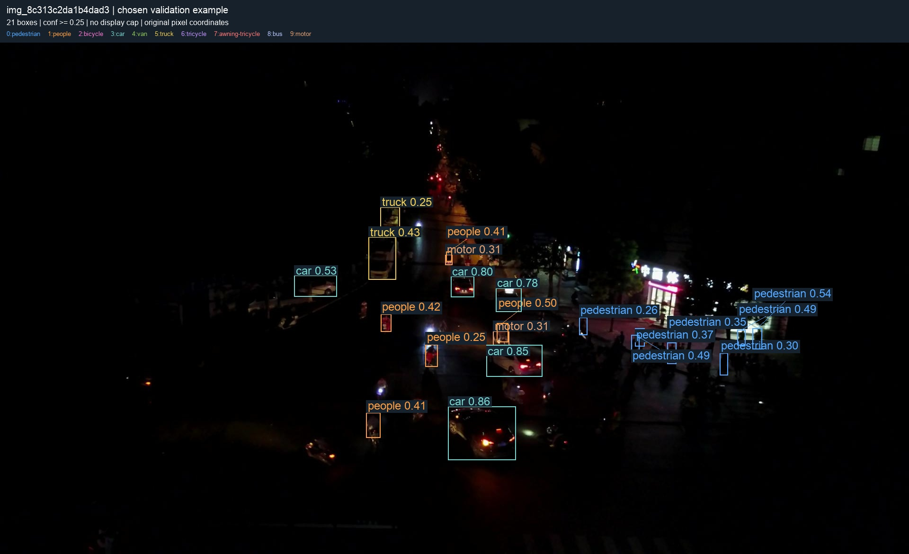
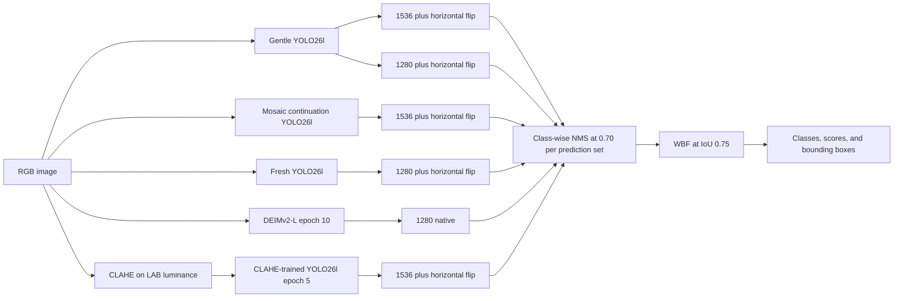

# Aerial Object Detection

### Small objects, challenging lighting, and detector fusion

[繁體中文](README.zh-TW.md) · [Experiment results](docs/EXPERIMENTS.md) · [Reproduction guide](docs/REPRODUCING.md) · [Data and visualization guide](docs/VISUALIZATION.md)

I developed this computer vision project to detect people and vehicles in aerial images, with a focus on small objects, crowded scenes, and low-light conditions. The work covers dataset analysis, detector fine-tuning, controlled preprocessing experiments, validation-based inference selection, and prediction fusion.

The final system combines **YOLO26l and DEIMv2-L**, using **six prediction sets from five checkpoints**. It reaches **0.35010 Kaggle public AP**, compared with **0.31851** for my best submitted single model, an absolute gain of **0.03159 AP**.

| Final validation AP | Validation AP-small | Kaggle public AP |
|---:|---:|---:|
| **0.39302** | **0.31657** | **0.35010** |

AP means mAP at IoU 0.50:0.05:0.95. Validation and Kaggle public results are measured on different image sets.

## Detection examples

The images below show predictions from the final ensemble. Click an image to inspect the full-resolution boxes and labels.

| Urban traffic | Low-light traffic |
|---|---|
| [](assets/urban_traffic.jpg) | [](assets/low_light_traffic.jpg) |
| Bridge traffic | Crowded night scene |
| [](assets/bridge_traffic.jpg) | [](assets/crowded_night.jpg) |

For readability, these figures display predictions with confidence ≥ 0.25. Evaluation and submission use a 0.001 threshold and a 300-detection cap. The two upper examples are test images; the two lower examples are validation images. These are qualitative examples, not evidence that every displayed prediction is correct. [Image provenance](assets/provenance.json)

## Task and dataset

This was an individual project for **NTU Computer Vision Practice with Deep Learning, 2026**. Each RGB image can contain multiple instances of ten categories:

`pedestrian`, `people`, `bicycle`, `car`, `van`, `truck`, `tricycle`, `awning-tricycle`, `bus`, `motor`.

| Split | Images | Use |
|---|---:|---|
| Train | 4,500 | Parameter updates |
| Validation | 700 | Checkpoint selection, inference tuning, and evaluation |
| Test | 1,800 | Final inference and Kaggle evaluation |

The main challenges are tiny bounding boxes, dense scenes, changing illumination, and unequal class frequencies. I used the assignment training split for fine-tuning and generic pretrained detectors for initialization.

## What I implemented

- **Data analysis:** examined box sizes and brightness distributions to choose experiments.
- **Training:** built independent and continued YOLO26l runs; adapted DEIMv2-L classification heads and learning rates to ten target classes.
- **Controlled comparisons:** matched the optimizer-update budget for original-image versus CLAHE training and for two mosaic settings.
- **Inference:** combined larger input scales, horizontal-flip augmentation, class-wise NMS, and Weighted Boxes Fusion.
- **Evaluation and reproduction:** retained validation/public results, fixed deployment settings, checkpoint hashes, and CSV serialization rules.

The detector architectures and generic pretrained weights come from the upstream projects. My work focuses on their adaptation, experimental design, evaluation, and integration.

## Final method



Each YOLO prediction set includes unflipped and horizontally flipped views, with boxes mapped back to original coordinates. The CLAHE-trained branch applies its fixed luminance preprocessing before both views; other branches use unchanged images. DEIM does not use flip.

| Checkpoint | Training path | Inference sets |
|---|---|---|
| Gentle YOLO26l | 960-pixel training followed by gentle continuation | 1280 + flip; 1536 + flip |
| Fresh YOLO26l, epoch 37 | Independent 1280-pixel training | 1280 + flip |
| Mosaic 0.3 YOLO26l, epoch 10 | Ten-epoch continuation from Fresh37 | 1536 + flip |
| DEIMv2-L, epoch 10 | Adapted COCO head initialization and layer-specific learning rates | Native 1280 + NMS |
| CLAHE YOLO26l, epoch 5 | Five-epoch continuation from Gentle on CLAHE images | CLAHE input, 1536 + flip |

**Fusion settings.** Class-wise WBF uses IoU 0.75, equal prediction-set weights `[0.5, 0.5, 0.5, 0.5, 0.5, 0.5]`, and `box_and_model_avg` confidence aggregation. Member scores and box coordinates are rounded to six and three decimals before fusion. I load one model at a time. The complete recipe is in [configs/final_ensemble.json](configs/final_ensemble.json).

**Pretraining.** YOLO26l starts from official generic Objects365 v1 → COCO weights. DEIMv2-L uses the official DINOv3/COCO checkpoint. Upstream sources and the pinned DEIM revision are documented in [THIRD_PARTY.md](THIRD_PARTY.md).

### CLAHE: local contrast preprocessing

**Contrast Limited Adaptive Histogram Equalization** adjusts contrast within local image regions. Histogram clipping limits excessive contrast amplification, which can otherwise amplify noise. [OpenCV explanation](https://docs.opencv.org/4.x/d5/daf/tutorial_py_histogram_equalization.html)

In this project, I convert RGB/BGR to LAB, process only the **L (luminance) channel**, then blend **50% original L + 50% enhanced L**. The fixed settings are `clipLimit=2.0` and `tileGridSize=(8, 8)`, dividing the image into eight tiles along each axis. Processing happens at original resolution before resizing, preserving image geometry and box coordinates. The CLAHE branch uses the same policy during training and inference. [Implementation](src/luminance_clahe.py)

### WBF: combine overlapping predictions

**Weighted Boxes Fusion** groups overlapping boxes of the same class and averages their coordinates using confidence and prediction-set weights. This lets several predictions contribute to one final location. [Original paper](https://arxiv.org/abs/1910.13302)

Here, each prediction set first uses class-wise NMS at IoU **0.70**. Cross-set WBF then matches boxes at IoU **0.75**, where IoU is intersection area divided by union area. All six sets have weight **0.5**; Gentle contributes two sets because it runs at two scales. Fused confidence uses `box_and_model_avg`, accounting for the contributing sets and their weights. [Fusion code](src/fuse.py)

## Results

| Method | Valid AP | AP-small | Kaggle public AP |
|---|---:|---:|---:|
| Gentle YOLO26l, 1280 | 0.33757 | 0.26512 | 0.30215 |
| Gentle YOLO26l, 1536 + flip | 0.35351 | 0.29044 | 0.31851 |
| Gentle + Fresh, two-set WBF | 0.37190 | 0.29838 | 0.33266 |
| Three-set WBF, adding Gentle1280 | 0.37707 | 0.30134 | 0.33574 |
| Four-set WBF | 0.38066 | 0.30439 | 0.33877 |
| Four-set WBF with mosaic continuation | 0.38316 | 0.30679 | 0.33955 |
| Five-set WBF, adding DEIMv2-L | 0.39158 | 0.31288 | 0.34863 |
| **Final six-set WBF, adding CLAHE YOLO** | **0.39302** | **0.31657** | **0.35010** |

Adding DEIMv2-L to the four YOLO prediction sets improves validation AP by approximately **0.00842** and public AP by **0.00908**. Its standalone validation AP is lower than Gentle's, but its predictions improve the combined result.

Adding the CLAHE-trained, CLAHE-input pool improves validation AP by **0.00144**, AP-small by **0.00369**, and public AP by **0.00147** over the five-set ensemble. The final public winner is not the candidate with the highest validation AP.

The [experiment record](docs/EXPERIMENTS.md) contains **35 completed public submissions**, **36 full-validation configurations**, and the final **24-configuration calibration search**, including unsuccessful experiments.

## Strategies and findings

### Preserve small-object detail

The fraction of training boxes with a short side below eight pixels drops from **26.44% at 960** to **15.53% at 1280**. Larger inference plus flipping improves Gentle's AP-small from **0.26512 to 0.29044**. I also tested crops, tiled inference, and a P2 head; these did not displace the final configuration. The Fresh training run changes several factors, so it is not a controlled resolution-only comparison.

### Fuse complementary predictions

I selected inference and fusion settings using validation predictions, then fixed each candidate recipe before its test fusion. The last five submissions reused saved predictions and required no new GPU run. The final gain comes from both scale variation and different checkpoints, including a transformer-based detector. Equal weights apply to prediction sets, so Gentle contributes two sets.

### Measure preprocessing instead of assuming it helps

I compared original-image and CLAHE continuations with the same initialization, seed, five-epoch budget, and **538 successful optimizer updates per arm**. CLAHE changes only the LAB luminance channel, with clip limit 2, an 8×8 grid, and 0.5 blending.

On unchanged validation images, CLAHE training changes AP by **−0.00246** and AP-small by **−0.00494** relative to its matched control. In the final fusion study, adding the CLAHE-trained model with CLAHE input improves the ensemble, so I retain it as a sixth prediction set. Its weaker standalone result and its complementary ensemble contribution are different comparisons. Earlier gamma/exposure augmentation and class-frequency weighting also did not improve the selected Gentle baseline.

### Keep execution within the memory budget

I used sequential model loading, gradient accumulation, and a CUDA memory guard. The matched YOLO training runs peaked at **8,522.9 MiB**, and the new test-inference runs in the final study peaked at **2,940.9 MiB**. These are observed measurements for those runs, not a general latency or memory benchmark for every configuration.

## Run the project

Run commands from this repository's root. Replace `/DATA` with the absolute path to the original assignment dataset. Data, trained weights, and generated outputs are excluded from Git.

### 1. Install dependencies

Full training uses **Linux, Python 3.12, and an NVIDIA CUDA GPU with native BF16 support**. Recorded runs used an L4 and a CUDA 13.0 PyTorch wheel; the driver must support that wheel.

```bash
python3.12 -m venv .venv
source .venv/bin/activate
python -m pip install torch==2.11.0 torchvision==0.26.0 --index-url https://download.pytorch.org/whl/cu130
python -m pip install -r requirements.txt
python -m pip install -r requirements-viz.txt
```

### 2. Prepare and inspect the data

```text
/DATA/
├── classes.txt
├── sample_submission.csv
├── images/{train,val,test}/
├── labels/{train,val}/
└── annotations/{instances_train.json,instances_val.json}
```

The dataset already provides YOLO labels and COCO annotations. [Data preparation](src/prepare_dataset.py) checks the original annotations, writes a YOLO dataset YAML, and maps image IDs to integers for DEIM. Class IDs remain **0–9** and source files are preserved.

```bash
# Optional: inspect the prepared formats in a separate preview directory.
python src/prepare_dataset.py --data-root /DATA --output outputs/data_preview

# Class counts, box sizes/density, and annotated train/validation samples.
python src/analyze_dataset.py --data-dir /DATA --output-dir outputs/eda
```

The [analysis script](src/analyze_dataset.py) produces `summary.json`, `class_distribution.png`, `density_and_box_scale.png`, `samples_train.jpg`, and `samples_val.jpg`. Train is used for parameter updates; validation is used for selection and tuning.

### 3. Retrain the five checkpoints

This portfolio provides a complete retraining workflow. Original project checkpoints are not distributed here; their identities and optional installation instructions are in the [checkpoint guide](checkpoints/README.md).

```bash
bash src/retrain_all.sh /DATA
```

The [training pipeline](src/retrain_all.sh) prepares `outputs/data`, downloads verified generic pretrained weights, and runs **Initial → Gentle**, independent **Fresh1280 → Mosaic0.3**, **DEIMv2-L**, and **Gentle → CLAHE**. It registers the five resulting checkpoints under `checkpoints/` and writes their recipe to `outputs/retrained_deployment.json`.

Start with no existing training outputs or trained checkpoint files. The optional `outputs/data_preview` above is separate from the pipeline's `outputs/data`. For individual stages, resuming, and exact training budgets, see the [reproduction guide](docs/REPRODUCING.md) and [training protocol](docs/TRAINING_PROTOCOL.md). This portable workflow has not been rerun end to end on a GPU; new weights require their own evaluation and may yield different scores.

### 4. Generate a submission

After retraining and registering the new models:

```bash
python src/infer.py \
  --images /DATA/images/test \
  --sample /DATA/sample_submission.csv \
  --recipe outputs/retrained_deployment.json \
  --workdir outputs/members \
  --output outputs/submission_test.csv \
  --device 0
```

This produces one row per test image after six-set WBF. Use new output paths for each run. If you already have the original checkpoints matching the recorded hashes, use `--recipe configs/final_ensemble.json` instead.

### 5. Visualize predictions and preprocessing

Draw saved CSV predictions for the two test examples shown above:

```bash
python src/visualize.py predictions \
  --images /DATA/images/test \
  --predictions outputs/submission_test.csv \
  --image-ids img_1ae8b7b991128bc7 img_2e9b763b691129bf \
  --confidence 0.25 \
  --output-dir outputs/visualizations

python src/visualize.py clahe \
  --image /DATA/images/val/img_8c313c2da1b4dad3.jpg \
  --output outputs/clahe_comparison.png
```

The [visualization code](src/visualize.py) runs on CPU, reads saved predictions, and records source hashes alongside its figures. It also supports ground-truth/prediction comparisons and COCO JSON input. `--confidence 0.25` controls display only; it does not change the submission or evaluation thresholds. The CLAHE command creates a side-by-side comparison using the actual training/inference transform. [Formats, Python example, and more commands](docs/VISUALIZATION.md)

### Code map

| Purpose | Entry point |
|---|---|
| Install a separately obtained original model archive | [download.sh](download.sh) · [download_models.py](src/download_models.py) |
| Dataset preparation / EDA | [prepare_dataset.py](src/prepare_dataset.py) · [analyze_dataset.py](src/analyze_dataset.py) |
| Complete retraining / individual trainers | [retrain_all.sh](src/retrain_all.sh) · [train.py](src/train.py) · [train_deim.py](src/train_deim.py) |
| CLAHE preprocessing | [luminance_clahe.py](src/luminance_clahe.py) |
| Inference / WBF / validation metrics | [infer.py](src/infer.py) · [fuse.py](src/fuse.py) · [evaluate.py](src/evaluate.py) |
| Prediction plots / CLAHE comparison | [visualize.py](src/visualize.py) |

## Repository structure

```text
assets/             Detection examples and image provenance
checkpoints/        Checkpoint placement instructions; weight files are ignored
configs/            Final ensemble, dataset example, and DEIM training recipe
docs/               Experiments, retraining, and visualization guides
experiments/deim/   Archived Colab training workers
results/            Recorded metrics in JSON
src/                Data preparation, EDA, training, inference, WBF, and visualization
src/vendor/         Pinned third-party inference sources and notices
requirements-viz.txt Optional Matplotlib dependency for EDA
```

## Limitations and next steps

- Validation and its calibration/audit subsets were reused. The reported validation gains are not independent holdout estimates, and the runs use one seed.
- The selected Kaggle score is public leaderboard feedback. It does not establish a private leaderboard result or generalization to another aerial dataset.
- DEIM continuation reached epoch 11 and stopped because of the compute budget **before early stopping was reached**. The submitted ensemble uses epoch 10; the epoch-11 fusion improved validation AP by only about 0.00012 and was not submitted.
- The inference recipe prioritizes accuracy. Throughput and deployment latency have not been benchmarked.
- Useful next experiments are an equal-update resolution comparison, multiple seeds for the strongest changes, and latency measurement followed by ensemble distillation.

## Acknowledgments

This project builds on [Ultralytics YOLO](https://docs.ultralytics.com/models/yolo26), [DEIMv2](https://github.com/Intellindust-AI-Lab/DEIMv2), and [Weighted Boxes Fusion](https://github.com/ZFTurbo/Weighted-Boxes-Fusion). The course provides the dataset and evaluation task. Third-party code and pretrained materials retain their own licenses; see [THIRD_PARTY.md](THIRD_PARTY.md).
